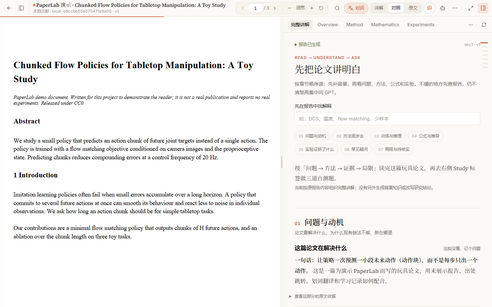
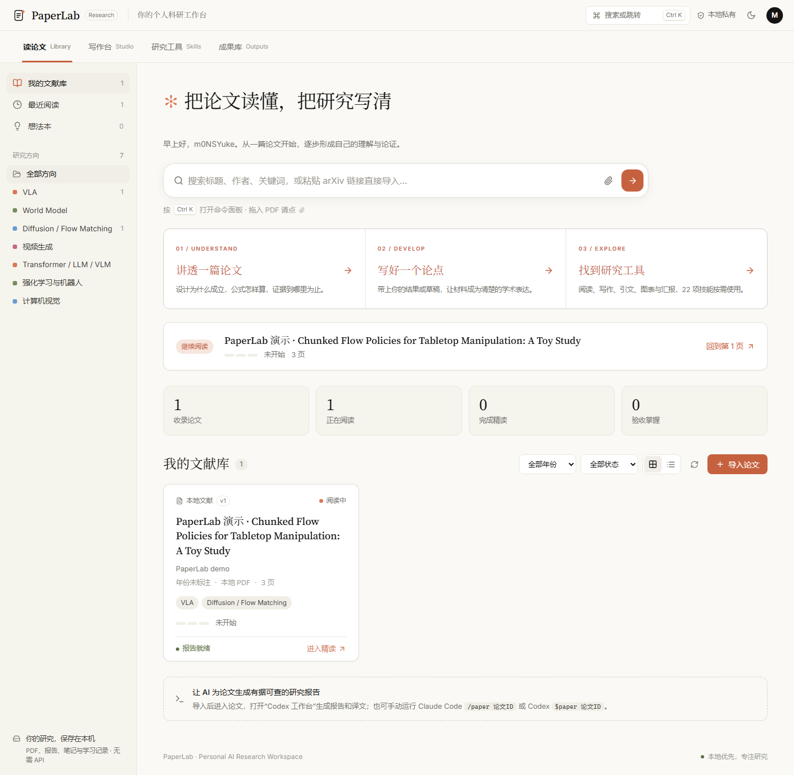
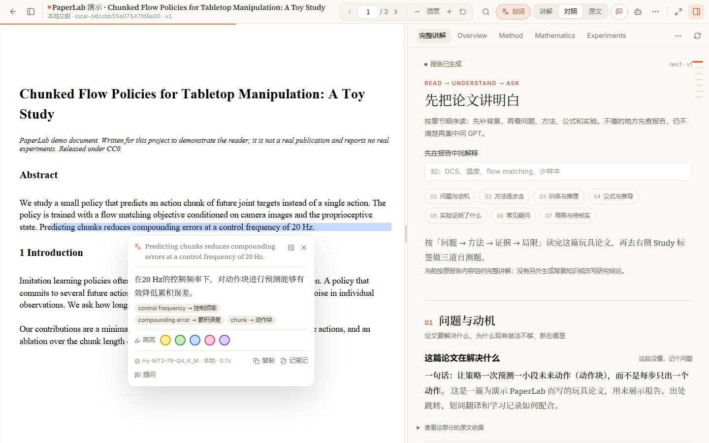
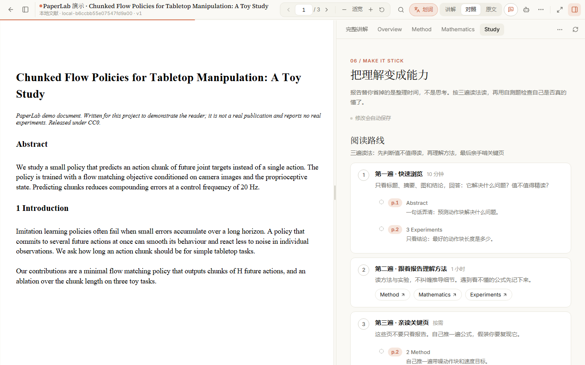
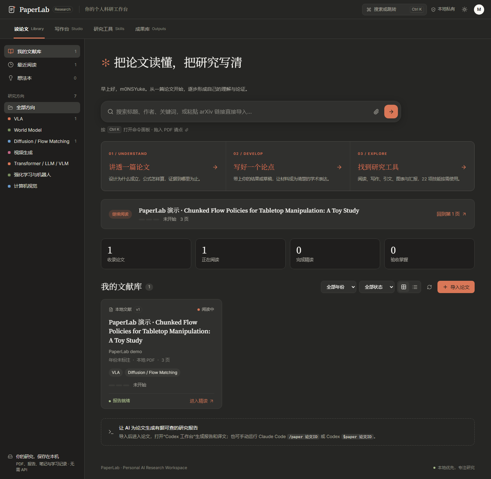

# PaperLab

**读懂论文，而不只是读完。** 一个在自己电脑上运行的 AI 科研论文阅读工作台：左边看原文 PDF，右边看有出处可查的中文讲解，选中英文即可离线翻译，读完用自测题和研究判断检验自己是否真的懂了。

*A local-first research-paper reading workspace: PDF and a source-verified Chinese explanation side by side, offline selection translation on your own GPU, and a study layer (three-pass reading route, self-tests, research judgment, idea notebook) that turns reading into understanding. Reports are written by your coding agent (Claude Code `/paper` or Codex `$paper`) and validated quote by quote before they reach the reader.*

[](https://github.com/m0NSYuke/PaperLab/actions/workflows/ci.yml)




> 仓库只包含平台本身，**不附带任何论文、报告或笔记**。论文由你自己导入；截图里的是项目自带的演示文档（自行撰写，CC0），用 `scripts/make_demo.py` 可以生成同样的演示。

| 文献库 | 划词翻译（离线） |
|---|---|
|  |  |
| **Study：把理解变成能力** | **深色主题** |
|  |  |

## 功能

**阅读**
- **Zotero 式阅读器**：一条 48px 工具栏，目录 / 阅读路线侧栏和讲解栏都能收起，`F` 专注阅读只留论文。PDF.js 渲染，原文搜索、缩放、书签、阅读位置自动保存。
- **有出处的报告**：每条结论都带原文页码和引句，点击即跳页并高亮；发布前逐条校验引句确实出现在该页，区分「论文事实 / 辅助解释 / 推断 / 待核实」。
- **四步读一篇论文**：① 速览（快速判断值不值得读、第一遍先看哪几页）→ ② 精读（一条连贯讲解：背景、问题、方法、训练推理、公式逐步推导、实验与证据审计、局限、关联研究，最后附每条结论的原文出处与纠错）→ ③ 自测与思考（自测题、研究判断、想法）→ ④ 笔记。每步末尾有「下一步」按钮；文献库卡片上的「自测与思考」可直接跳到第 ③ 步。
- **划词翻译**：选中英文即在旁边出译文，不做整篇翻译，原文始终是原始 PDF（见下）。

**划词翻译（全程离线，不占任何额度）**
- 单词和术语：77 万词条的 ECDICT 离线词典，加上 217 条 AI / 机器人学术术语库（ablation 显示「消融实验」而不是「切除」）。
- 整句：腾讯翻译专用模型 Hy-MT2 通过 llama.cpp 在本机显卡上运行，按需启动、空闲自动退出；术语库会注入提示词，译法保持统一。翻过的句子会缓存。
- 卡片里一键「加入术语表」，之后的翻译都按你的译法来。

**学习与研究判断**
- **自测与思考**：三遍读法阅读路线（点页码直接跳原文）、先写答案再对照的自测题、新意度 × 有效性 × 问题大小的价值打分、想法本（文献库汇总所有论文的想法）。
- **笔记与纠错**：Markdown + 公式笔记；对 AI 解释「标记问题」会作为事件保留，重新生成报告也不会覆盖人工内容。
- **带着上下文提问**：自动整理论文、页码和选中内容，复制到 Claude / ChatGPT / Kimi / DeepSeek，支持苏格拉底式追问和费曼检查两种模式。

**随记（不属于某一篇论文的想法）**
- 顶部导航「随记」：左边是随记列表（置顶、按最近修改排序、搜索标题 / 标签 / 正文），右边直接写。
- 截图直接粘贴或拖进来，图片在正文里原样显示，光标落到图片下一行接着写；也支持 Markdown、$公式$、代码段和「源码」模式。
- 边写边自动保存，`Ctrl S` 立即保存；删除后 10 秒内可撤销，文件进 `memos/.trash`，较早版本留在 `memos/.history`。
- 每条随记是数据目录 `memos/` 下的一个 Markdown 文件，图片在 `memos/assets/`，用 Typora、Obsidian 打开也能正常显示。

**按研究线整理文献**
- 文献库左侧「研究线」：按你在做的 idea 或方向分组，每条线有一句话说明要回答的问题，组内论文按阅读顺序排，卡片上写这篇在这条线上的作用（基线、基座、方法借鉴、风险……）。一篇论文可以在多条线里。
- 研究线写在数据目录的 `lines.json`，手动编辑即可（格式见 `backend/app/lines.py`）；「技术标签」仍按方法类别筛选。
- 概念卡片：精读的「背景知识」一章先列出这篇用到的通用概念（DiT、视频 VAE、投机解码、RLVR / GRPO、思维链……），点开是独立于论文的讲解和库内对应论文。
- 读完第 ③ 步可以「标记为已读完」，文献库里的「阅读中 / 已完成」就按真实进度统计。

**更多**
- `Ctrl K` 命令面板与全键盘操作；Claude 风格界面，深浅色主题；手机 / iPad 同一 Wi-Fi 下带口令访问。
- 科研工作台：接入 22 项 [Nature Skills](THIRD_PARTY_NOTICES.md) 科研任务（写作、润色、引用核查、绘图等，需单独安装）。

## 快速开始（Windows）

需要 Windows 10/11、Python 3.11+、Node.js 22.12+、Git。

```powershell
git clone https://github.com/m0NSYuke/PaperLab.git
cd PaperLab
powershell -NoProfile -ExecutionPolicy Bypass -File .\scripts\setup.ps1
```

`setup.ps1` 会安装后端（uv，装在项目内 `.tools/`，不改系统 Python）和前端依赖并完成构建。npm 源不稳定时加 `-Registry https://registry.npmmirror.com`。

然后双击 **Start-PaperLab.cmd**，浏览器打开 http://127.0.0.1:8000 ；停止用 **Stop-PaperLab.cmd**。

想先看看效果？生成演示论文和示例报告：

```powershell
.\backend\.venv\Scripts\python.exe -X utf8 scripts\make_demo.py
```

## 导入论文并生成报告

1. 在文献库首页输入框粘贴 arXiv 链接或 ID 回车即可导入（版本会被固定），也可以上传本地 PDF（最大 100 MB）。导入后马上能读。
2. 在本项目目录打开 Claude Code 运行 `/paper <arXiv ID 或 local-ID>`，或在 Codex 中运行 `$paper …`；也可以用阅读器里的「Codex 工作台」（使用你本机 Codex 的 ChatGPT 登录，不需要 API Key）。
3. 技能会读原文（arXiv 论文优先读 LaTeX 源码，见 [RAP](docs/RAP_INTEGRATION.md)），写出候选报告，再由发布器做结构和引句校验后才写入。校验失败不会覆盖已有报告。

```powershell
# 手动辅助命令：获取原文与页文本 / 发布候选报告
.\backend\.venv\Scripts\python.exe -X utf8 .agents\skills\paper\scripts\paper.py prepare 2410.24164v4
.\backend\.venv\Scripts\python.exe -X utf8 .agents\skills\paper\scripts\paper.py publish tmp\candidate-report.json
```

报告格式见 [docs/REPORT_SCHEMA.md](docs/REPORT_SCHEMA.md) 与 `docs/schemas/`。

## 可选：离线划词翻译

不装也能用划词：没有模型时只查词典；没有词典时卡片会提示。三样东西都放在项目内被忽略的 `models/` 文件夹（或在 `.env.local` 里指定其他位置，见 [.env.example](.env.example)）。

1. **词典**：下载 [ECDICT](https://github.com/skywind3000/ECDICT) 的 `ecdict.csv`，然后
   `.\backend\.venv\Scripts\python.exe scripts\build_dictionary.py ecdict.csv models\ecdict.db`
2. **翻译模型**：从 Hugging Face 下载 [Hy-MT2-7B-Q4_K_M.gguf](https://huggingface.co/tencent/Hy-MT2-7B-GGUF)（4.6 GB，8 GB 显存可全部放进 GPU）或更轻的 [Hy-MT2-1.8B](https://huggingface.co/tencent/Hy-MT2-1.8B-GGUF)（1.1 GB，CPU 也能跑）到 `models/`。
3. **运行时**：从 [llama.cpp Releases](https://github.com/ggml-org/llama.cpp/releases) 下载 Windows 版（NVIDIA 显卡选 CUDA 版本并附带 `cudart` 包），解压到 `models/llama.cpp/`。

第一次翻译整句时要把模型载入显卡，RTX 4060 上实测约 5 秒；之后每句约 1–2 秒。模型只监听 127.0.0.1，每次启动使用随机端口和一次性密钥，空闲 15 分钟自动退出。

## 可选：Nature Skills 科研技能

22 项科研任务技能来自第三方仓库 [Yuan1z0825/nature-skills](https://github.com/Yuan1z0825/nature-skills)（Apache-2.0），本仓库不附带。需要「写作台 / 研究工具」里的完整能力时安装：

```powershell
python scripts\install-nature-skills.py      # 下载固定版本并逐个文件校验哈希
python scripts\verify-nature-skills.py       # 可选：再次核验
```

## 在手机 / iPad 上看

电脑和设备在同一个自用 Wi-Fi 下时，先停止服务，再双击 **Start-PaperLab-LAN.cmd**，窗口会显示 `http://192.168.x.x:8000/?key=…`。在设备上打开一次即会记住口令（可添加到主屏幕），长按选中英文即可划词翻译。Windows 需把该网络设为「专用」。删除 `.runtime/lan-token` 可让旧链接失效。校园网等公共网络通常开启设备隔离，建议用手机热点。

## 隐私与数据

- 所有论文、报告、笔记和学习记录都是本机普通文件（JSON / Markdown），默认在项目文件夹里且被 Git 忽略；可用 `.env.local` 的 `PAPERLAB_DATA_DIR` 放到其他磁盘。
- 服务只绑定 127.0.0.1（局域网模式需口令）。网页本身不调用任何模型 API，也不需要 API Key；Codex 工作台调用的是你本机已登录的 Codex CLI，划词翻译完全离线。
- 自动备份：服务启动时和运行期间每 24 小时，把你写的所有东西（papers/、memos/、concepts/、knowledge/、research-outputs/、lines.json 和导入的本地 PDF）打成一个 zip，放到 `PAPERLAB_BACKUP_DIR`（默认 `~/PaperLab-backups`，与数据盘分开），没有变化就跳过，保留最近 10 份。文献库左下角显示上次备份时间，也可以「立即备份」。arXiv 的 PDF 与 LaTeX 可以重新下载，不进备份。恢复时把 zip 解压回数据目录即可。

```text
<数据目录>/
  papers/<ID>/<vN>/        metadata.json · report.json/md · notes.md · study.json · corrections.jsonl
  local-assets/<ID>/<vN>/  原始 PDF、LaTeX 源码、页文本缓存
  memos/                   随记：<id>.md · assets/ 图片 · .history/ 旧版本 · .trash/ 已删除
  lines.json               研究线：按 idea / 方向分组的论文与阅读顺序
  concepts/  knowledge/  research-outputs/
```

## 快捷键

`Ctrl K` 命令面板（输入页码直接跳页）· `1`–`4` 切换速览 / 精读 / 自测与思考 / 笔记 · `[` `]` 翻页 · `Ctrl F` 或 `/` 搜索原文 · `F` 专注阅读 · `T` 开关划词翻译 · `A` 带着上下文提问

## 项目结构

```text
frontend/          React 19 + TypeScript + Vite + PDF.js + KaTeX
backend/app/       FastAPI：导入、版本固定、存储、报告校验与发布、翻译、Codex 任务
backend/tests/     后端测试（pytest）
frontend/tests/    浏览器端到端测试（Playwright，自动生成演示论文，不用你的论文）
.agents/skills/    paper（报告生成）· rap（源码优先读论文）· nature-*（安装后出现）
.claude/skills/    Claude Code 的 /paper、/rap 入口
scripts/           安装、启动、测试、演示数据、词典构建、Nature Skills 安装
docs/              需求、架构、技术决策、报告 Schema
```

技术决策与取舍记录在 [docs/DECISIONS.md](docs/DECISIONS.md)。

## 开发与测试

```powershell
powershell -NoProfile -ExecutionPolicy Bypass -File .\scripts\test.ps1            # 后端测试 + 前端构建
powershell -NoProfile -ExecutionPolicy Bypass -File .\scripts\test.ps1 -Browser   # 再加 Chrome 端到端测试
```

开发时：`.\backend\.venv\Scripts\python.exe -m uvicorn app.main:app --app-dir backend --port 8000`，另开终端 `cd frontend; npm run dev`，访问 http://127.0.0.1:5173 。GitHub Actions 会在每次推送时运行后端测试和前端构建。

## 常见问题

- **端口被占用 / 启动失败**：查看 `.runtime/server-error.log`；停止脚本只结束自己启动的服务。
- **引用没有高亮**：PDF 字形和断行可能让原句无法完整搜索，仍会跳到对应页；引句校验证明文字存在，不等于语义正确，重要结论请核对原文。
- **扫描版 PDF**：不做 OCR，内容分析会标注受限。
- **划词翻译显示「本地模型不存在」**：检查 `models/` 或 `.env.local` 里的路径；词典可以单独使用。
- **系统支持**：脚本面向 Windows；后端与前端本身跨平台，macOS / Linux 需自行用 uv 和 npm 启动。

## 许可与致谢

PaperLab 以 [MIT](LICENSE) 许可发布。第三方技能、依赖、模型与设计参考的来源和许可见 [THIRD_PARTY_NOTICES.md](THIRD_PARTY_NOTICES.md)：Nature Skills（Yuan1z0825，Apache-2.0）、`read-arxiv-paper` 方法（karpathy/nanochat，MIT）、PDF.js、ECDICT、腾讯 Hy-MT2、llama.cpp 等。你导入的论文版权归原作者与对应许可所有。
